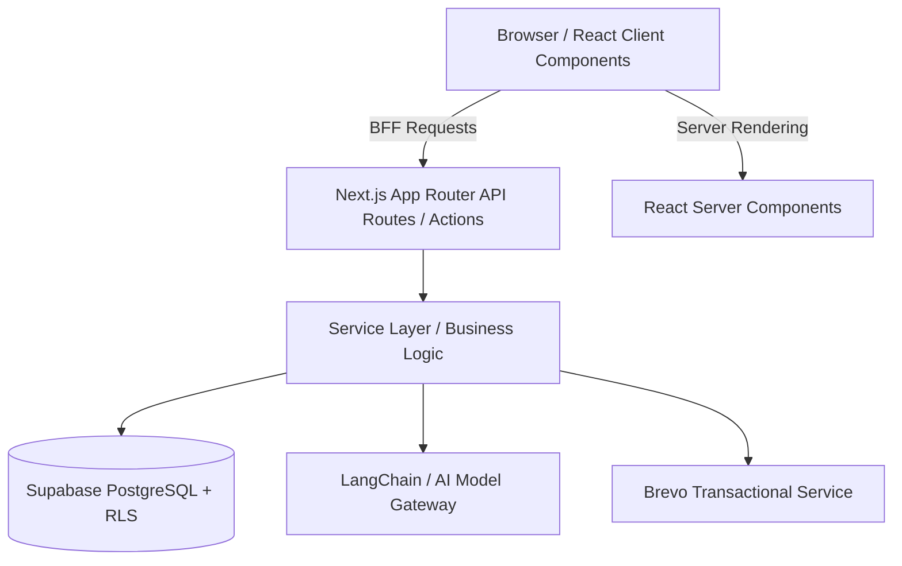

# Guia de Padrões Arquiteturais & Plano de Estudos - MENVO
> Documento gerado pelo Gemini / Antigravity para consolidar os padrões de design (Design Patterns), boas práticas de engenharia e cronograma de aprendizado prático no ecossistema do **Menvo**.

---

## 🧭 Sumário
1. [Visão Geral da Arquitetura](#1-visão-geral-da-arquitetura)
2. [Padrões de Arquitetura & Backend](#2-padrões-de-arquitetura--backend)
3. [Padrões de Frontend & Componentes (React / Next.js)](#3-padrões-de-frontend--componentes-react--nextjs)
4. [Padrões de IA & Governança de Dados (LGPD)](#4-padrões-de-ia--governança-de-dados-lgpd)
5. [Plano de Estudos Prático (4 Semanas)](#5-plano-de-estudos-prático-4-semanas)
6. [Sugestões Estratégicas para o Produto](#6-sugestões-estratégicas-para-o-produto)

---

## 1. Visão Geral da Arquitetura

O **Menvo** é construído como uma aplicação moderna no ecossistema **Next.js (App Router)** com **TypeScript Estrito**, persistência no **Supabase (PostgreSQL + RLS)**, integração com modelos de IA de fronteira via **LangChain / LangGraph** e envio de e-mails transacionais via **Brevo**.



### Princípios Cardinais do Repositório:
- **Clean Separation:** Componentes e hooks nunca consultam o banco diretamente; toda mutação e leitura passam por `lib/services/` ou rotas `app/api/`.
- **Security First:** Nenhuma rota que atenda usuário final pode burlar o RLS (Row Level Security). O uso de `service_role` é estritamente restrito a fluxos privilegiados (ex: atribuição RBAC no `/api/admin/verify`).
- **Strict TypeScript:** Proibido uso de `any`. Schemas Zod em todas as fronteiras externas (parâmetros, responses e formulários).
- **React Server Components por padrão:** `"use client"` somente quando estritamente necessário (interações, eventos, APIs do navegador).

---

## 2. Padrões de Arquitetura & Backend

### 2.1. Service Layer Pattern (Camada de Serviço)
- **Definição:** Isola as regras de negócio e o acesso a dados da camada de transporte HTTP / Apresentação.
- **Por que usamos:** Permite testar as regras de negócio unitariamente sem mockar requisições HTTP (`NextRequest`) e evita que mudanças no banco afetem as telas.
- **Onde ver no código:**
  - [`lib/services/mentorship/mentorship.service.ts`](file:///c:/Users/paulm/OneDrive/Ambiente%20de%20Trabalho/PROJETOS/menvo/lib/services/mentorship/mentorship.service.ts): Coordena agendamentos, próximos encontros e avaliações.
  - [`lib/services/verifications/notification.service.ts`](file:///c:/Users/paulm/OneDrive/Ambiente%20de%20Trabalho/PROJETOS/menvo/lib/services/verifications/notification.service.ts): Coordena o fluxo de aprovação/rejeição/ajustes de mentores, atualização no banco, envio no chat e e-mail.
  - [`lib/services/organizations/org-leads.service.ts`](file:///c:/Users/paulm/OneDrive/Ambiente%20de%20Trabalho/PROJETOS/menvo/lib/services/organizations/org-leads.service.ts): Gerencia intenções de parceria B2B.

### 2.2. BFF (Backend for Frontend)
- **Definição:** Rotas de backend criadas sob medida para fornecer exatamente os dados exigidos por uma determinada interface ou jornada de usuário.
- **Por que usamos:** Reduz round-trips da aplicação, centraliza tratamento de erros e previne o vazamento de chaves ou permissões para o navegador.
- **Onde ver no código:**
  - `app/api/dashboard/mentor/route.ts` & `app/api/dashboard/mentee/route.ts`: Agregam métricas, feedbacks e agendamentos para carregamento instantâneo dos painéis.
  - `app/api/admin/verifications/pending/route.ts`: Entrega a lista de candidatos aguardando análise com joins consolidados.

### 2.3. Facade & Adapter Pattern (Fachada e Adaptador)
- **Definição:** Fornece uma interface unificada e simplificada sobre bibliotecas complexas ou APIs de terceiros.
- **Por que usamos:** Se a Menvo migrar do Brevo para outro provedor (ex: Resend) ou trocar o Google Calendar, apenas a camada do Adapter muda.
- **Onde ver no código:**
  - [`lib/email/brevo.ts`](file:///c:/Users/paulm/OneDrive/Ambiente%20de%20Trabalho/PROJETOS/menvo/lib/email/brevo.ts): Fachada que gerencia layouts oficiais da marca, assinaturas personalizadas, higienização HTML e envio SMTP.
  - `lib/chat/chat-service.ts`: Abstrai conversas e mensagens sem que o chamador saiba detalhes das tabelas `chats`/`messages`.

### 2.4. Single Source of Truth & Projeções Derivadas
- **Definição:** Cada estado do domínio existe em exatamente uma coluna; flags acessórias ou agregadas são calculadas dinamicamente.
- **Por que usamos:** Evita inconsistências críticas onde um usuário estava marcado como "aprovado" em uma tabela, mas "pendente" em outra.
- **Onde ver no código:**
  - Coluna `mentor_profiles.verification_status`: Única fonte da verdade no PostgreSQL.
  - [`lib/services/mentors/mentor-profile-fields.ts`](file:///c:/Users/paulm/OneDrive/Ambiente%20de%20Trabalho/PROJETOS/menvo/lib/services/mentors/mentor-profile-fields.ts): Função pura `withMentorFields` que deriva `verified` (`status === 'approved'`) e `is_pending_mentor` (`status === 'pending' || status === 'changes_requested'`).
  - View SQL `mentors_view`: Projeção que calcula status e estatísticas em tempo de consulta.

### 2.5. Guard & Interceptor Pattern (Portões de Acesso)
- **Definição:** Componentes e middlewares que interceptam a execução para validar permissões, papéis ou pendências contratuais antes da exibição do conteúdo.
- **Onde ver no código:**
  - [`lib/auth/auth-guard.tsx`](file:///c:/Users/paulm/OneDrive/Ambiente%20de%20Trabalho/PROJETOS/menvo/lib/auth/auth-guard.tsx): Exporta `<RequireRole>`, `<RequireAuth>` e `<RequireAdmin>`.
  - [`components/legal/TermsGate.tsx`](file:///c:/Users/paulm/OneDrive/Ambiente%20de%20Trabalho/PROJETOS/menvo/components/legal/TermsGate.tsx): Intercepta qualquer navegação e exige aceite dos Termos de Uso vigentes caso haja nova versão.

---

## 3. Padrões de Frontend & Componentes (React / Next.js)

### 3.1. Compound Components & Slot Pattern (`asChild`)
- **Definição:** Componentes que compartilham contexto internamente, permitindo construir layouts complexos de forma declarativa e com zero poluição de divs desnecessárias no DOM.
- **No Menvo:** Primitivas do **Radix UI** estilizadas com Tailwind CSS (`<Dialog>`, `<Tabs>`, `<AlertDialog>`).
- **Exemplo Prático:**
  ```tsx
  <Dialog open={open} onOpenChange={setOpen}>
    <DialogTrigger asChild>
      <Button variant="outline">Ajustar perfil</Button>
    </DialogTrigger>
    <DialogContent>
      <DialogHeader>
        <DialogTitle>Título do Modal</DialogTitle>
      </DialogHeader>
      {/* Conteúdo flexível */}
    </DialogContent>
  </Dialog>
  ```

### 3.2. Container vs. Presentational (Smart & Dumb Components)
- **Definição:** 
  - **Containers (Smart):** Conectam-se a dados, gerenciam estados complexos, disparam mutações e tratam erros.
  - **Presentational (Dumb):** Funções puras que recebem props e emitem callbacks (`onClick`, `onChange`), facilitando testes e reuso.
- **Onde ver no código:**
  - Smart: [`AdminVerificationsPage`](file:///c:/Users/paulm/OneDrive/Ambiente%20de%20Trabalho/PROJETOS/menvo/app/%5Blocale%5D/dashboard/admin/verifications/page.tsx) (carrega listas, lida com filtros e submissões).
  - Dumb: [`MentorReviewDraftPanel`](file:///c:/Users/paulm/OneDrive/Ambiente%20de%20Trabalho/PROJETOS/menvo/components/admin/MentorReviewDraftPanel.tsx) (apenas renderiza pontos fortes, lacunas e inputs).
  - Dumb: [`MentorChangesRequestedBanner`](file:///c:/Users/paulm/OneDrive/Ambiente%20de%20Trabalho/PROJETOS/menvo/components/dashboard/MentorChangesRequestedBanner.tsx) (renderiza o card de aviso no dashboard).

### 3.3. Custom Hooks como Máquinas de Estado
- **Definição:** Encapsulamento de ciclo de vida, caching e sincronização em hooks reutilizáveis.
- **Onde ver no código:**
  - `useAuth`: Mantém sessão, usuário autenticado e papéis RBAC em cache.
  - `useFavorites`: Gerencia adição/remoção de mentores favoritos com persistência.
  - `useLatestQuiz`: Lê o último diagnóstico de carreira do usuário e revalida o cache automaticamente após submissões.

---

## 4. Padrões de IA & Governança de Dados (LGPD)

### 4.1. Human-in-the-Loop (HITL)
- **Definição:** A IA atua como assistente ou copiloto executando tarefas cognitivas (resumir, analisar perfis, apontar lacunas), mas a decisão de aprovação, envio de recado ou rejeição é tomada obrigatoriamente por um humano.
- **Onde ver no código:**
  - [`components/admin/MentorReviewAssistant.tsx`](file:///c:/Users/paulm/OneDrive/Ambiente%20de%20Trabalho/PROJETOS/menvo/components/admin/MentorReviewAssistant.tsx): O assistente de IA lê o perfil do candidato, elenca pontos fortes e rascunha a mensagem, mas o botão de envio só é acionado pelo administrador após revisão.

### 4.2. Data Scoping & Redaction (Privacidade e LGPD)
- **Definição:** Sanitização e filtragem cirúrgica de dados sensíveis antes de compartilhá-los com outros usuários ou com LLMs.
- **Onde ver no código:**
  - [`lib/services/diagnostic/diagnostic-shares.service.ts`](file:///c:/Users/paulm/OneDrive/Ambiente%20de%20Trabalho/PROJETOS/menvo/lib/services/diagnostic/diagnostic-shares.service.ts): Aplica escopos estritos (`summary` vs `full`), ocultando respostas pessoais de perguntas do diagnóstico antes de disponibilizá-las ao mentor.

### 4.3. Multi-Model Factory & Circuit Breaker
- **Definição:** Padrão de fábrica (`Factory`) desacoplado de um fornecedor de IA único, permitindo alternar dinamicamente entre Google Gemini, Groq, OpenAI ou gateways compatíveis.
- **Onde ver no código:**
  - [`lib/ai/models/factory.ts`](file:///c:/Users/paulm/OneDrive/Ambiente%20de%20Trabalho/PROJETOS/menvo/lib/ai/models/factory.ts): Instancia o modelo LangChain correto e injeta callbacks de medição e controle de cotas.

---

## 5. Plano de Estudos Prático (4 Semanas)

Cronograma progressivo para estudar e dominar a arquitetura aplicada no Menvo:

### 🗓️ Semana 1: Arquitetura em Camadas & TypeScript Estrito
- **Tema:** *Separation of Concerns* e *Domain Services*.
- **Leituras Recomendadas:**
  - Martin Fowler — *Service Layer* e *Data Mapper*.
  - Regras de arquitetura do projeto em [`AGENTS.md`](file:///c:/Users/paulm/OneDrive/Ambiente%20de%20Trabalho/PROJETOS/menvo/AGENTS.md).
- **Mão na massa no Menvo:**
  1. Abra [`lib/services/verifications/verification-list.service.ts`](file:///c:/Users/paulm/OneDrive/Ambiente%20de%20Trabalho/PROJETOS/menvo/lib/services/verifications/verification-list.service.ts) e veja como a consulta ao Supabase não vaza para as Route Handlers.
  2. Implemente uma função utilitária em um arquivo `.test.ts` e execute com `npm test`.

### 🗓️ Semana 2: Composição Avançada em React 19 & Next.js
- **Tema:** *Compound Components*, *Slot/asChild* e *Server/Client Boundaries*.
- **Leituras Recomendadas:**
  - Documentação do **Radix UI** (Conceitos de Composição).
  - Skill do repositório: [`.agent/skills/react-composition-patterns/SKILL.md`](file:///c:/Users/paulm/OneDrive/Ambiente%20de%20Trabalho/PROJETOS/menvo/.agent/skills/react-composition-patterns/SKILL.md).
- **Mão na massa no Menvo:**
  1. Examine [`components/admin/MentorReviewAssistant.tsx`](file:///c:/Users/paulm/OneDrive/Ambiente%20de%20Trabalho/PROJETOS/menvo/components/admin/MentorReviewAssistant.tsx) e veja como `<Dialog>`, `<Tabs>` e `<Textarea>` interagem de forma desacoplada.
  2. Analise como o [`MentorChangesRequestedBanner.tsx`](file:///c:/Users/paulm/OneDrive/Ambiente%20de%20Trabalho/PROJETOS/menvo/components/dashboard/MentorChangesRequestedBanner.tsx) foi inserido em dois dashboards diferentes com zero repetição de código.

### 🗓️ Semana 3: Banco de Dados Relacional, Views & RLS no Supabase
- **Tema:** *Single Source of Truth*, Políticas RLS e Migrations determinísticas.
- **Leituras Recomendadas:**
  - Documentação do Supabase: *Row Level Security (RLS)*.
  - Documento de modelo do Menvo: [`docs/domains/profiles-schema.md`](file:///c:/Users/paulm/OneDrive/Ambiente%20de%20Trabalho/PROJETOS/menvo/docs/domains/profiles-schema.md).
- **Mão na massa no Menvo:**
  1. Estude a migration recente [`supabase/migrations/20261015020000_mentor_profiles_changes_requested.sql`](file:///c:/Users/paulm/OneDrive/Ambiente%20de%20Trabalho/PROJETOS/menvo/supabase/migrations/20261015020000_mentor_profiles_changes_requested.sql).
  2. Veja como a nova função de RPC [`supabase/migrations/20261015030000_mentor_public_stats.sql`](file:///c:/Users/paulm/OneDrive/Ambiente%20de%20Trabalho/PROJETOS/menvo/supabase/migrations/20261015030000_mentor_public_stats.sql) usa `security definer` para entregar apenas agregados públicos sem expor linhas brutas.

### 🗓️ Semana 4: Arquiteturas de IA Seguras com LangGraph & HITL
- **Tema:** Agentes de IA, Roteamento Semântico e Human-in-the-Loop.
- **Leituras Recomendadas:**
  - LangChain Documentation — *Chat Models and Structured Output*.
  - Artigo: *Human-in-the-loop Design Patterns for LLM applications*.
- **Mão na massa no Menvo:**
  1. Explore [`lib/ai/models/factory.ts`](file:///c:/Users/paulm/OneDrive/Ambiente%20de%20Trabalho/PROJETOS/menvo/lib/ai/models/factory.ts) e veja como a fábrica suporta modelos diferentes via contratos comuns.
  2. Analise a rota `app/api/admin/verifications/draft/route.ts` para entender como o prompt gera JSON estruturado com Zod.

---

## 6. Sugestões Estratégicas para o Produto

Pensando na proposta de valor da Menvo (mentoria voluntária com propósito + IA de carreira):

1. **Check-in Pós-Sessão Rápido (Redução de Fricção):**
   - Enviar notificação transacional ou mensagem automática 10 minutos após o horário previsto da mentoria: *"A sessão com Fulano aconteceu? [Sim] / [Não]"*. 
   - Ao clicar em "Sim", já libera a geração do Certificado de Horas e coleta a nota de avaliação em 1 clique.
2. **Match Inteligente Pós-Quiz:**
   - Na tela de resultado do Diagnóstico de Carreira (`/quiz/results/[id]`), conectar o resultado aos mentores ativos que dominam as lacunas detectadas pela IA.
3. **LinkedIn One-Click Share para Certificados:**
   - Na página de certificado ([`/certificate/[id]`](file:///c:/Users/paulm/OneDrive/Ambiente%20de%20Trabalho/PROJETOS/menvo/app/%5Blocale%5D/certificate/%5Bid%5D/page.tsx)), incluir botão direto para adicionar a licença/certificação voluntária diretamente no perfil do LinkedIn.
4. **Política de Assiduidade (No-Show Prevention):**
   - Para valorizar a doação de tempo dos mentores, criar penalidade suave de reagendamento para mentorados que faltarem sem aviso prévio de 24h.

---
*Documento de referência para a equipe de engenharia do Menvo.*
